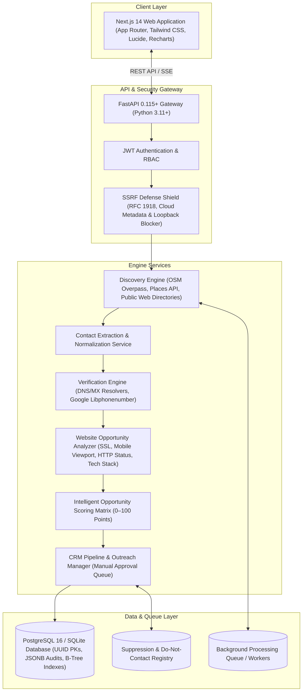
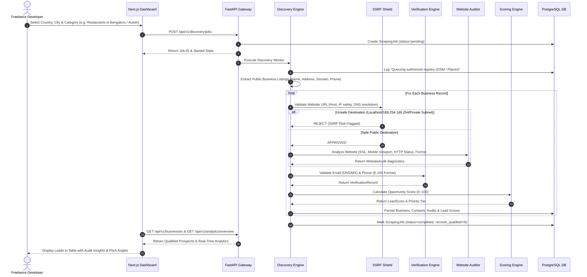
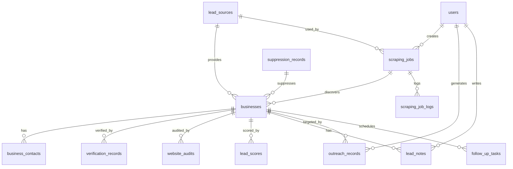

# ProspectIQ — System Design & Technical Architecture Document

## 1. Executive Summary & Objective

**ProspectIQ** is an intelligent, full-stack client acquisition platform engineered specifically for freelance web developers and creative digital agencies. The platform automates the discovery of businesses worldwide (with dedicated optimization for Bengaluru, India and major international markets), validates publicly available contact information, audits their digital infrastructure for actionable web development opportunities, calculates weighted conversion opportunity scores (0–100), and organizes prospects through a full CRM pipeline.

### Core Philosophy
1. **Worldwide Market Scalability**: Seamlessly discover prospects in Bengaluru, India (Indiranagar, Koramangala, Whitefield, Jayanagar) and international commercial hubs (Austin, San Francisco, London, Sydney, Singapore, Berlin, Toronto).
2. **Strict Contact Provenance & Ethical Harvesting**: Only extract publicly listed business contact information from authorized sources. Never scrape private individuals, personal mobile numbers, or bypass CAPTCHAs/access controls.
3. **Evidence-Based Opportunity Scoring**: Rank leads according to technical deficiencies that freelancers can solve (missing website, broken SSL, unresponsiveness on mobile devices, broken links, missing contact forms).
4. **Anti-Spam & Regulatory Protection**: Zero automated mass mailing or cold robocalls. All communication requires manual approval and is checked against an active suppression list. Complies with Indian TRAI/DPDP, EU GDPR, and US CAN-SPAM standards.

---

## 2. High-Level Architecture Topology

---

## 3. End-to-End Discovery & Qualification Pipeline

---

## 4. Database Schema Specification

All tables utilize UUID string primary keys (`CHAR(36)`), UTC timestamps, relational foreign keys with cascading delete rules, and JSONB structures for extensible audit traces.

### Table Definitions

#### 1. `users`
| Column | Type | Constraints | Description |
| :--- | :--- | :--- | :--- |
| `id` | `VARCHAR(36)` | Primary Key | UUID v4 |
| `email` | `VARCHAR(255)` | Unique, Not Null, Index | User login email |
| `hashed_password` | `VARCHAR(255)` | Not Null | Bcrypt hashed password |
| `full_name` | `VARCHAR(255)` | Nullable | User display name |
| `role` | `VARCHAR(50)` | Not Null, Default='developer' | Role: developer, admin |
| `is_active` | `BOOLEAN` | Not Null, Default=True | Account active flag |
| `created_at` | `DATETIME` | Not Null, Default=utcnow | Creation timestamp |
| `updated_at` | `DATETIME` | Not Null, Default=utcnow | Update timestamp |

#### 2. `lead_sources`
| Column | Type | Constraints | Description |
| :--- | :--- | :--- | :--- |
| `id` | `VARCHAR(36)` | Primary Key | UUID v4 |
| `name` | `VARCHAR(100)` | Unique, Not Null | Source name |
| `source_type` | `VARCHAR(50)` | Not Null | `open_osm`, `google_places`, `public_directory` |
| `description` | `VARCHAR(255)` | Nullable | Description of registry |
| `reliability_score`| `FLOAT` | Not Null, Default=0.85 | Trust weight (0.00 – 1.00) |
| `is_authorized` | `BOOLEAN` | Not Null, Default=True | Authorization flag |
| `rate_limit_per_minute` | `INTEGER` | Not Null, Default=60 | Crawler rate limit |

#### 3. `scraping_jobs` & `scraping_job_logs`
- `scraping_jobs`: Manages asynchronous discovery runs with fields for `target_country`, `target_city`, `target_postal_code`, `target_category`, `status` (`pending`, `running`, `completed`, `failed`, `cancelled`), `progress_pct`, `records_found`, `records_qualified`, and timestamps.
- `scraping_job_logs`: Event stream tracking logs (`level`, `message`, `extra_data`, `timestamp`).

#### 4. `businesses`
| Column | Type | Constraints | Description |
| :--- | :--- | :--- | :--- |
| `id` | `VARCHAR(36)` | Primary Key | UUID v4 |
| `job_id` | `VARCHAR(36)` | Foreign Key -> `scraping_jobs.id` | Discovery job reference |
| `source_id` | `VARCHAR(36)` | Foreign Key -> `lead_sources.id` | Originating data source |
| `name` | `VARCHAR(255)` | Not Null, Index | Commercial business name |
| `legal_name` | `VARCHAR(255)` | Nullable | Registered legal entity name |
| `category` | `VARCHAR(100)` | Not Null, Index | Business category |
| `sub_category` | `VARCHAR(100)` | Nullable | Sub-specialty |
| `address_line1` | `VARCHAR(255)` | Nullable | Street address |
| `city` | `VARCHAR(100)` | Not Null, Index | City (Bengaluru, Austin, etc.) |
| `state_province`| `VARCHAR(100)` | Nullable | State / Region |
| `postal_code` | `VARCHAR(50)` | Nullable, Index | PIN / ZIP Code |
| `country` | `VARCHAR(100)` | Not Null, Index | Country name |
| `latitude` | `FLOAT` | Nullable | Geolocation latitude |
| `longitude` | `FLOAT` | Nullable | Geolocation longitude |
| `official_website`| `VARCHAR(500)` | Nullable | Target website URL |
| `normalized_domain`| `VARCHAR(255)` | Nullable, Index | Clean domain name |
| `crm_status` | `VARCHAR(50)` | Not Null, Default='new' | CRM stage |
| `is_suppressed` | `BOOLEAN` | Not Null, Default=False | Anti-spam suppression flag |

#### 5. `business_contacts`
Tracks email addresses, phone numbers, and inquiry URLs with specific verification states (`unverified`, `valid_syntax`, `mx_confirmed`, `invalid`, `disposable`) and provenance links.

#### 6. `website_audits`
Captures diagnostic metrics: `has_website`, `is_reachable`, `http_status`, `load_time_ms`, `has_ssl`, `is_mobile_friendly`, `has_contact_form`, `broken_links_count`, `technologies_detected` (JSON), and `opportunities_identified` (JSON).

#### 7. `lead_scores`
Stores calculated 0–100 scores along with priority tiers (`high`, `good`, `medium`, `low`) and individual sub-factor contributions.

#### 8. `crm` & `outreach_records`
Maintains `lead_notes`, `follow_up_tasks`, `suppression_records`, and `outreach_records` requiring `manual_approval_granted = True` before sending.

---

## 5. Security & SSRF Shield Architecture

Website crawlers are vulnerable to Server-Side Request Forgery (SSRF) when scanning user-specified URLs. ProspectIQ enforces a multi-layer defense shield prior to initiating any network connection:

1. **Scheme Validation**: Only `http://` and `https://` are permitted. Schemes like `file://`, `gopher://`, `ftp://`, and `javascript:` are rejected.
2. **Hostname Disqualification**: Explicitly denies `localhost`, `127.0.0.1`, `::1`, and cloud metadata hostnames (`metadata.google.internal`, `instance-data`).
3. **DNS Pre-Resolution**: Authoritative DNS resolution is performed before socket connection.
4. **IP Range Blacklisting**:
   - `127.0.0.0/8` (Loopback)
   - `10.0.0.0/8`, `172.16.0.0/12`, `192.168.0.0/16` (RFC 1918 Private networks)
   - `169.254.0.0/16` (Link-local & AWS/GCP/Azure Metadata `169.254.169.254`)
   - `224.0.0.0/4` (Multicast)
   - `0.0.0.0/8` (Current network)
5. **DNS Rebinding Guard**: Re-verifies resolved IP addresses on redirects.

---

## 6. Mathematical Lead Scoring Matrix (0–100 Points)

ProspectIQ calculates a weighted opportunity score $S$ representing how urgently a business needs website development or redesign services:

$$S = S_{\text{noweb}} + S_{\text{unreach}} + S_{\text{ssl}} + S_{\text{mobile}} + S_{\text{contact}} + S_{\text{perf}} + S_{\text{auth}} + S_{\text{email}}$$

| Factor | Condition | Maximum Points |
| :--- | :--- | :--- |
| **No Official Website** | Business has no detectable web presence | **+30 Points** |
| **Website Unavailable** | Website returns 4xx/5xx HTTP errors or fails to resolve | **+25 Points** |
| **Missing SSL / Insecure** | Website serves plain HTTP or has invalid/expired SSL | **+15 Points** |
| **Poor Mobile Layout** | Missing viewport meta tag, un-responsive layout | **+15 Points** |
| **Missing Contact Functionality** | No contact form, broken inquiry widget | **+10 Points** |
| **Performance Issues** | Load time > 3,500ms or bloated assets | **+5 Points** |
| **Business Authenticity** | Identity corroborated across official sources | **+5 Points** |
| **Public Email Verified** | Valid MX record verified email available for pitch | **+5 Points** |

### Priority Tiers
- **80 – 100 Points**: **High Priority** (Ideal prospect: No website or completely broken presence with verified contact).
- **60 – 79 Points**: **Good Opportunity** (Outdated website, no SSL, poor mobile experience).
- **40 – 59 Points**: **Medium Priority** (Functional website with minor performance/SEO deficiencies).
- **0 – 39 Points**: **Low Priority** (Modern, fast, fully responsive website with active SSL).

---

## 7. Global Multi-Market Scalability

ProspectIQ is designed to operate globally:
- **Geographic Coverage**: Supports all countries using ISO 3166-1 alpha-2 codes.
- **Geospatial Discovery**: Integrates OpenStreetMap Overpass query language with bounding boxes, city tags, and coordinates.
- **Telephone Normalization**: Google’s `phonenumbers` library parses and validates local phone formats (e.g. Indian 10-digit mobile numbers `+91 98450 XXXXX`, US 10-digit `+1 512 XXX XXXX`, UK landlines `+44 20 XXXX XXXX`) into standardized E.164 strings.
- **Postal & PIN Code Support**: Accommodates alphanumeric postal codes (UK `WC1V 6BX`), 5-digit US ZIPs (`78701`), and Indian 6-digit PIN codes (`560038`).

---

## 8. Anti-Spam & Legal Regulatory Compliance

1. **Indian TRAI & DPDP Act 2023**:
   - Zero automated commercial communications.
   - All generated pitches must be manually reviewed and sent by the freelancer.
   - Public business directory provenance is preserved on every contact record.
2. **EU GDPR**:
   - Only processes public corporate business data; excludes private individuals.
   - Built-in `SuppressionRecord` table enables instant compliance with opt-out / Right to Erasure requests.
3. **US CAN-SPAM Act**:
   - Enforces physical business address inclusion in generated email drafts.
   - Pre-formats clear opt-out / unsubscribe footers.

---

## 9. Technology Stack Matrix

| Layer | Technology | Selection Rationale |
| :--- | :--- | :--- |
| **Frontend Framework** | Next.js 14 (App Router) | High-performance React framework with server components and optimal SEO |
| **Styling** | Tailwind CSS & PostCSS | Rapid utility-first styling with modern dark/light contrast |
| **UI Components** | Custom shadcn/ui compatible components | Clean, minimal, accessible, enterprise SaaS dashboard feel |
| **Icons** | Lucide React | Lightweight, consistent iconography |
| **Backend Framework** | FastAPI (Python 3.11+) | Asynchronous, typed with Pydantic v2, automatic OpenAPI documentation |
| **ORM & Database** | SQLAlchemy 2.0 & PostgreSQL / SQLite | Robust normalized models, ACID compliance, JSONB support |
| **Scraping & Verification** | HTTPX, BeautifulSoup4, dnspython, phonenumbers | SSRF-safe crawling, real DNS/MX inspection, international E.164 parsing |
| **Security** | native `bcrypt` & `python-jose` | Modern password hashing without legacy wrap bugs; secure JWT auth |
| **Testing** | Pytest, Pytest-Asyncio | Automated unit, security, and integration test coverage |
| **Containerization** | Docker & Docker Compose | Multi-container reproducible production deployment |

